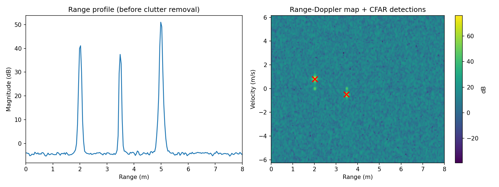

# FMCW mmWave Radar Simulation

Python simulation of a 60 GHz FMCW radar (similar to TI IWR6843) that detects moving people and ignores static objects. This is the idea behind radar as a privacy-friendly alternative to cameras.



## Pipeline
1. **IF signal simulation**: beat signal for each target (range, velocity, amplitude) plus noise
2. **Range FFT** (Hann window): distance
3. **Static clutter removal**: subtract the mean over chirps (removes walls and furniture)
4. **Doppler FFT**: velocity
5. **2D CA-CFAR**: adaptive-threshold target detection

## Parameters
| Parameter | Value |
|---|---|
| Start frequency | 60 GHz |
| Bandwidth | 4 GHz → range resolution 3.75 cm |
| Samples / chirps | 256 / 128 |
| Chirp repetition | 200 µs → velocity resolution ≈ 0.1 m/s |

## Run
```bash
pip install -r requirements.txt
python radar_sim.py     # prints detections, saves range_doppler.png
pytest -q               # checks that both people are detected and the wall is removed
```

## Next steps (ideas)
- Angle estimation with multiple RX antennas (angle FFT)
- Micro-Doppler / breathing-rate detection for a person standing still
- Tracking across frames (Kalman filter)
- Run the same pipeline on real data from a TI mmWave board
